# DogNerd

Web extension to provide oodles of extra information to [Dog Online](https://dogonline.net).

## Features

### Collection

Entries you haven't found yet show as silhouettes, with outlines around groups that share where they're found.

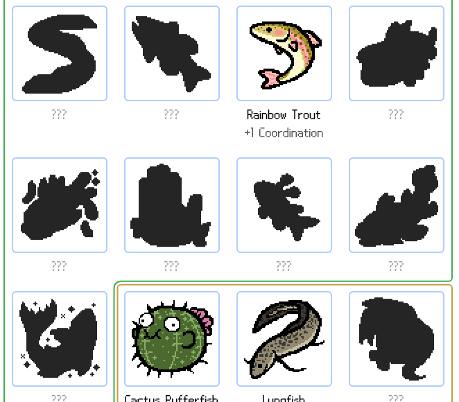

Clicking an unfound entry shows where and how to get it.

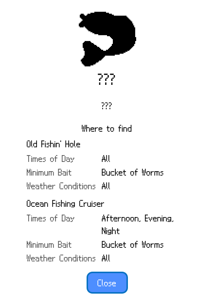

### Item badges

Item cards across the site show how many you have in your doghouse, storage and closet, how many are up for trade, and whether your dog has eaten or read it yet.

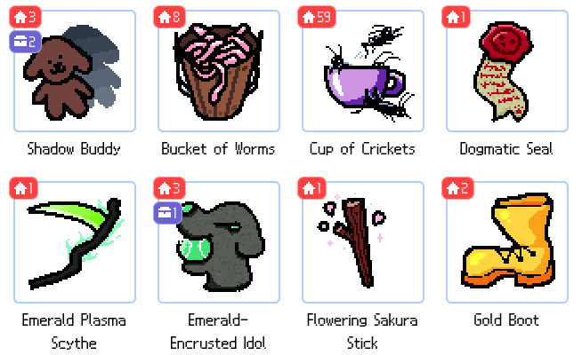

### Doghouse

**Put All Clothes in Closet** moves every cosmetic to the closet. **Smart Store** also sends extras to storage, keeping bait, seeds, uneaten food, unread books and enough combat items for a tower loadout.

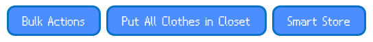

### Up for trade

Mark items as up for trade from their dialog or with bulk actions. They're set aside in their own section of the doghouse, and the list can be copied as text or as an image to share.

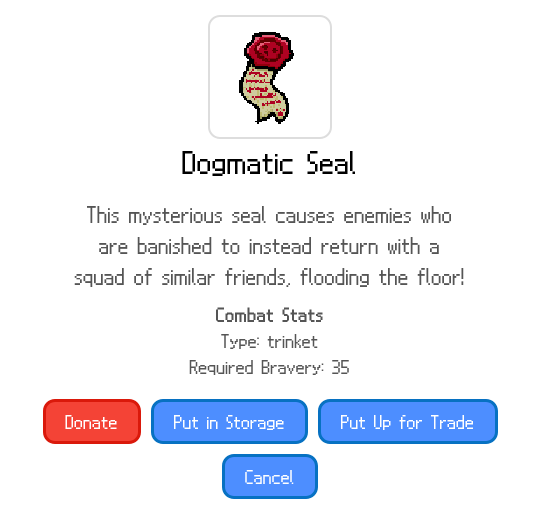

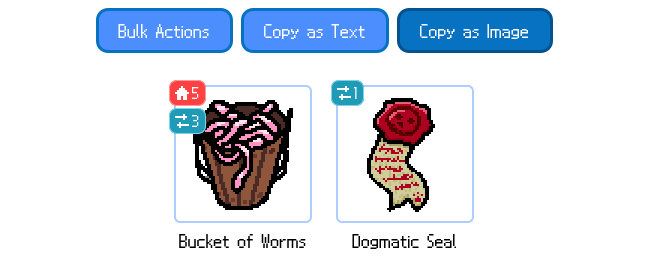

### Fishing

Bait that can catch a fish you haven't caught yet, given the current time and weather, is marked with a "!".

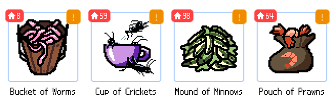

The bait dialog shows which fish it can catch here right now.

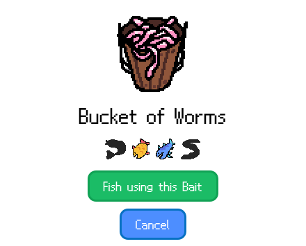

A counter shows how many times you've fished today.

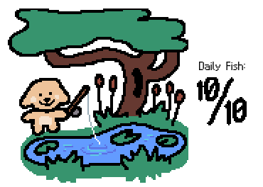

### New day timer

The weather message counts down to the next day.

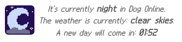

### Farm

A plot's dialog shows every variant of its crop, with the ones you haven't harvested yet blacked out.

### Tower

- Turns left on effects like riposting, shown on the item that started them.
- How many enemies are queued up after slicing one in two.
- Status effects on you and the enemy, as colored labels.
- A map for the cheese maze that follows where you are and draws the way to the cheese and any unopened chests.

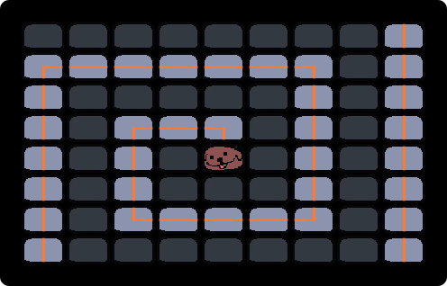

## TODO

- Torment Nexus extra info

## Special Thanks

- Thank you to all the dogonline wiki editors to which this extension would not be possible without.
- Thank you to the dog online discord for being an awesome place.
- And thank YOU for using this extension <3
